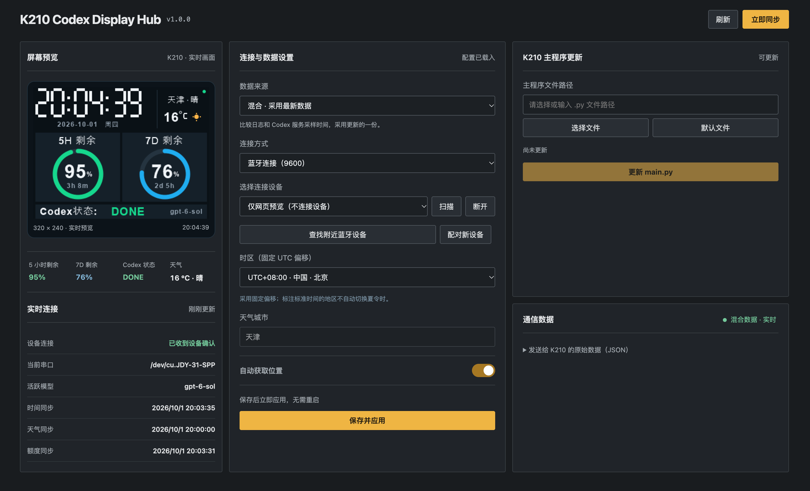

<div align="center">
  
  <h1>K210 Codex Display Hub</h1>
  <p>在 K210 小屏和本机网页查看 Codex 额度、任务状态、时间与天气。</p>
  <p>
    
    
    
  </p>
  <p><a href="#features">功能</a> · <a href="#preview">预览</a> · <a href="#start">运行</a> · <a href="#device">连接设备</a></p>
</div>

K210 Codex Display Hub 包含 macOS 上位机、网页控制台和 K210 板端程序。上位机从本机 Codex 日志或 Codex 服务获取额度，通过 Type-C 串口更新设备画面；没有设备时也能使用网页预览和演示模式。

<a id="features"></a>

## ✨ 功能特性

- **Codex 状态**：显示 5 小时与 7 天额度、当前任务状态和模型。任务状态根据本机日志推断。
- **两种桌面**：在 Codex 信息页与数字时钟页之间切换；同时显示时间和天气。
- **网页预览**：在浏览器查看并点击 K210 画面，设置串口、数据来源、时区和天气。
- **触屏设置**：在 K210 上切换桌面、翻转屏幕、调节亮度并查看设备信息。
- **同步与更新**：支持手动同步、设备端点击 7D 额度圈同步，以及通过串口更新 `main.py`。
- **菜单栏应用**：打开控制台、查看连接状态、同步、重连和设置开机自启。

<a id="preview"></a>

## 📸 界面预览

下图是实际运行的演示模式；额度和天气是模拟数据，未连接 K210。

<div align="center">
  
</div>

<a id="start"></a>

## 📦 安装与运行

上位机需要 macOS 和 Python 3。使用真实数据需要本机 Codex 日志或已登录的 Codex 命令行程序；演示模式不需要 K210 或 Codex 账号。在项目根目录运行：

```bash
python3 -m venv .venv
.venv/bin/python -m pip install -r requirements.txt
.venv/bin/python run.py --source demo --serial '' --open
```

控制台默认地址为 <http://127.0.0.1:2100>；端口可在配置中修改。读取真实数据时运行 `.venv/bin/python run.py`。从源码启动 macOS 菜单栏应用可运行 `.venv/bin/python tray_app.py`。

<a id="device"></a>

## 🔌 连接 K210

1. 用 CanMV IDE 将 `K210/main.py` 和 `K210/program_update.py` 保存到开发板同一目录：使用 MicroSD 时分别为 `/sd/main.py`、`/sd/program_update.py`，否则分别为 `/flash/main.py`、`/flash/program_update.py`，然后重启设备。主程序将在线更新代码延后加载，以给屏幕画布留出启动内存。
2. 断开 CanMV IDE 对串口的占用。在网页中选择“USB 连接（115200）”，扫描并选择 K210 的 Type-C 串口，然后点击“连接”。
3. 点击“连接”，等待页面显示“已收到设备确认”。

### 外接蓝牙串口（HC-05 等）

P7 是 K210 的 IO7/TX，接 HC-05 的 RX；P6 是 IO6/RX，接 HC-05 的 TX；两端 GND 必须相连。HC-05 的 VCC 应按所购模块底板的标注供电，TX/RX 使用 3.3V 逻辑电平。

## ⚙️ 配置与开发

源码运行时，设置保存在项目根目录的 `config.local.json`；打包应用保存在 `~/Library/Application Support/K210 Codex Display Hub/config.json`。配置模板见 `config.example.json`。默认数据来源为本机日志，天气默认自动定位；网页中可改为手动城市。`config.local.json` 已被 Git 忽略。

使用 Codex 服务时，上位机会从 PATH、常见 CLI 安装目录及 `/Applications`、`~/Applications` 中的 ChatGPT/Codex 应用包查找 `codex`。菜单栏启动不继承终端 PATH；若使用其他安装位置，可将配置中的 `codex_bin` 设为可执行文件的绝对路径，然后重启上位机。天气与额度独立查询；天气错误会区分自动定位、城市查询和天气查询，并提示超时、DNS 或 HTTPS 等原因。

测试与 macOS 打包：

```bash
.venv/bin/python -m pip install -r requirements-build.txt
.venv/bin/python -B -m unittest discover -s tests -v
.venv/bin/python build.py
```

打包结果位于 `dist/K210 Codex Display Hub.app`。修改板端字体后，可用 `.venv/bin/python tools/generate_fonts.py --check` 核对两份 K210 程序的字形。

## 🔐 数据说明

上位机可读取 `~/.codex` 中的会话日志，或调用本机 `codex app-server` 查询额度。天气使用 Open-Meteo；默认自动定位会请求 `ipwho.is`，由该服务看到公网 IP。网页服务仅监听 `127.0.0.1`，接口没有登录认证，不要将其端口公开。在线更新会改写设备程序，请先确认所选文件。

网页预览按需生成：前台每秒刷新，隐藏时每 10 秒仅获取状态，关闭网页后不再绘制预览。后台继续设备通信、额度查询和天气更新；默认每 5 分钟查询服务额度、每 20 分钟更新天气。

当前仓库尚未配置 Git 远程地址，也没有 `LICENSE` 文件；公开发布前需补充。
